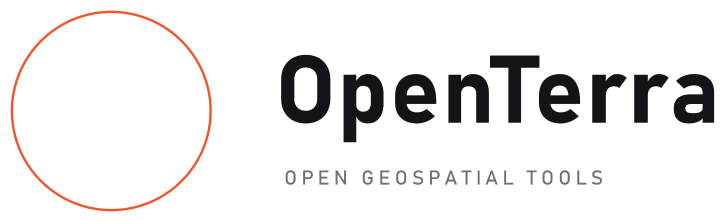
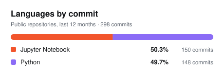

## Hi, I'm Ammar Yasser

**GIS Developer · Open-source contributor · Cartography** — Giza, Egypt

I transform complex spatial data into actionable insights. I build **geospatial data-quality tools**, automate **OpenStreetMap** workflows, and do **spatial analysis** in Python. I maintain the **OpenTerra** tools (geoqa, ovc, GeoNest and more), and contribute fixes and docs to the Python GIS ecosystem.

- **Working on:** high-precision automated map editing and spatial QC tools
- **Learning:** ML models for satellite-imagery feature extraction
- **Ask me about:** Python for GIS, PostGIS optimization, cartography

---

## OpenTerra

  <picture>
    <source media="(prefers-color-scheme: dark)" srcset="assets/openterra/openterra-lockup-dark.svg">
    
  </picture>

**OpenTerra** is my family of open geospatial tools: check the quality of GIS data, map it, and handle everyday coordinate and file chores.

### Spatial data quality

Start with **geoqa** to profile a layer, then let **ovc** find the conflicts. [Try both in 5 minutes →](https://github.com/AmmarYasser455/ovc/tree/main/examples/geoqa-to-ovc)

| Project | What it does | Use it from |
|---|---|---|
| [**geoqa**](https://github.com/AmmarYasser455/geoqa) | Profile any geodataset in one line: validity, CRS, duplicates, completeness, a quality score and an HTML report | Python, CLI ·  |
| [**ovc**](https://github.com/AmmarYasser455/ovc) | Find overlapping buildings, buildings on roads and boundary problems; writes a GeoPackage, metrics CSV and web map | Python, CLI |
| [**ovc-arcgis-pro**](https://github.com/AmmarYasser455/ovc-arcgis-pro) | Five OVC checks as an ArcGIS Pro toolbox: building overlaps, building–road conflicts, road dangles, disconnected roads, self-intersections | ArcGIS Pro |
| [**horus-qc**](https://github.com/AmmarYasser455/horus-qc) | Building and road QC for grid-based digitising: classified overlaps, roof-to-base shift, keyboard review queue | QGIS 3 & 4 plugin |

### Mapping and analysis

| Project | What it does |
|---|---|
| [**GeoNest**](https://github.com/AmmarYasser455/GeoNest) | Lightweight mapping in Jupyter on ipyleaflet: basemaps, vector and raster layers in a few lines |
| [**Cairo Hex Grid Analysis**](https://github.com/AmmarYasser455/Cairo-Hex-Grid-Analysis-using-Python) | Case study: how amenities spread across Cairo, on a hexagonal grid built from OpenStreetMap · [live demo](https://cairo-hex-analysis-by-ammaryasser.netlify.app/) |

### Small utilities

<!--START_SECTION:gis-tools-->
One job each, with a command-line tool and tests. Install any of them with `pip install git+https://github.com/AmmarYasser455/<name>`.

| Tool | What it does | Try it |
|---|---|---|
| <picture><source media="(prefers-color-scheme: dark)" srcset="https://raw.githubusercontent.com/AmmarYasser455/crs-sniffer/main/assets/brand/logo-dark.svg"></picture> [**crs-sniffer**](https://github.com/AmmarYasser455/crs-sniffer) | Guess the most likely coordinate reference system (EPSG) of a list of coordinates or a GeoJSON/CSV file from value ranges and known projected extents. | [notebook](https://colab.research.google.com/github/AmmarYasser455/crs-sniffer/blob/main/examples/demo.ipynb) |
| <picture><source media="(prefers-color-scheme: dark)" srcset="https://raw.githubusercontent.com/AmmarYasser455/utm-zone-finder/main/assets/brand/logo-dark.svg"></picture> [**utm-zone-finder**](https://github.com/AmmarYasser455/utm-zone-finder) | Find the right UTM zone and EPSG code for a latitude/longitude, a bounding box or a GeoJSON file, including the Norway/Svalbard exceptions. | [notebook](https://colab.research.google.com/github/AmmarYasser455/utm-zone-finder/blob/main/examples/demo.ipynb) |
| <picture><source media="(prefers-color-scheme: dark)" srcset="https://raw.githubusercontent.com/AmmarYasser455/dms-convert/main/assets/brand/logo-dark.svg"></picture> [**dms-convert**](https://github.com/AmmarYasser455/dms-convert) | Parse and convert coordinates between decimal degrees, degrees-minutes-seconds and degrees-decimal-minutes, with tolerant parsing of messy real-world input. | [notebook](https://colab.research.google.com/github/AmmarYasser455/dms-convert/blob/main/examples/demo.ipynb) |
| <picture><source media="(prefers-color-scheme: dark)" srcset="https://raw.githubusercontent.com/AmmarYasser455/tile-math/main/assets/brand/logo-dark.svg"></picture> [**tile-math**](https://github.com/AmmarYasser455/tile-math) | Convert between lat/lon, XYZ web-map tiles and quadkeys, and list the tiles covering a bounding box at a zoom level. | [notebook](https://colab.research.google.com/github/AmmarYasser455/tile-math/blob/main/examples/demo.ipynb) |
| <picture><source media="(prefers-color-scheme: dark)" srcset="https://raw.githubusercontent.com/AmmarYasser455/csv-to-geojson/main/assets/brand/logo-dark.svg"></picture> [**csv-to-geojson**](https://github.com/AmmarYasser455/csv-to-geojson) | Turn a CSV with coordinates into GeoJSON, auto-detecting latitude/longitude column names and formats, and reporting rows it could not parse. | [notebook](https://colab.research.google.com/github/AmmarYasser455/csv-to-geojson/blob/main/examples/demo.ipynb) |
| <picture><source media="(prefers-color-scheme: dark)" srcset="https://raw.githubusercontent.com/AmmarYasser455/gpx-to-geojson/main/assets/brand/logo-dark.svg"></picture> [**gpx-to-geojson**](https://github.com/AmmarYasser455/gpx-to-geojson) | Convert GPX tracks, routes and waypoints to GeoJSON with timestamps, elevation and per-track distance and duration. | [notebook](https://colab.research.google.com/github/AmmarYasser455/gpx-to-geojson/blob/main/examples/demo.ipynb) |
| <picture><source media="(prefers-color-scheme: dark)" srcset="https://raw.githubusercontent.com/AmmarYasser455/geohash-kit/main/assets/brand/logo-dark.svg"></picture> [**geohash-kit**](https://github.com/AmmarYasser455/geohash-kit) | Encode and decode geohashes, find neighbours, and cover a polygon with geohashes at a chosen precision. | [notebook](https://colab.research.google.com/github/AmmarYasser455/geohash-kit/blob/main/examples/demo.ipynb) |
<!--END_SECTION:gis-tools-->

### Web

- [**Portfolio**](https://ammaryasser455.github.io/): my GIS project atlas, built with React, TypeScript and Vite

---

## Open-source contributions

<!--START_SECTION:contributions-->
**5 merged** · **4 in review** · **7 projects** (updated 20 Nov 2026)

#### Merged

| Project | Pull request | Merged |
|---|---|---|
| [thinkingmachines/geowrangler](https://github.com/thinkingmachines/geowrangler) | [#272](https://github.com/thinkingmachines/geowrangler/pull/272) fix: clarify error in raster_to_dataframe.generate_mask when labels_column is missing | Nov 2026 |
| [geopandas/geopandas](https://github.com/geopandas/geopandas) | [#3723](https://github.com/geopandas/geopandas/pull/3723) DOC: clarify sindex.query behavior with predicates | Apr 2026 |
| [thinkingmachines/geowrangler](https://github.com/thinkingmachines/geowrangler) | [#267](https://github.com/thinkingmachines/geowrangler/pull/267) fix: FastBingTileGridGenerator CRS conversion and polygon holes handling | Feb 2026 |
| [geoinquiets/rafagas](https://github.com/geoinquiets/rafagas) | [#994](https://github.com/geoinquiets/rafagas/pull/994) ci: modernize link-checker workflow | Feb 2026 |
| [osm-search/Nominatim](https://github.com/osm-search/Nominatim) | [#3955](https://github.com/osm-search/Nominatim/pull/3955) docs: fix multiple typos in documentation and source code | Feb 2026 |

#### In review

| Project | Pull request | Opened |
|---|---|---|
| [scikit-mobility/scikit-mobility](https://github.com/scikit-mobility/scikit-mobility) | [#296](https://github.com/scikit-mobility/scikit-mobility/pull/296) Fix shapely >=2.1.0 compatibility (#293) | Feb 2026 |
| [shapely/shapely](https://github.com/shapely/shapely) | [#2414](https://github.com/shapely/shapely/pull/2414) doc: add 'See Also' sections to geometry class docstrings | Jan 2026 |
| [nnamera/road-ml-pipeline](https://github.com/nnamera/road-ml-pipeline) | [#2](https://github.com/nnamera/road-ml-pipeline/pull/2) docs: remove invalid binary links and update installation instructions | Jan 2026 |
| [nnamera/road-ml-pipeline](https://github.com/nnamera/road-ml-pipeline) | [#1](https://github.com/nnamera/road-ml-pipeline/pull/1) fix(tests): resolve widespread failures in pipeline, training, and model modules | Jan 2026 |
<!--END_SECTION:contributions-->

---

## Recent activity

<!--START_SECTION:activity-->
1. Opened issue [#494](https://github.com/qgis/QGIS-Plugins-Website/issues/494) in [qgis/QGIS-Plugins-Website](https://github.com/qgis/QGIS-Plugins-Website)
2. Opened PR [#7](https://github.com/AmmarYasser455/Cairo-Hex-Grid-Analysis-using-Python/pull/7) in [AmmarYasser455/Cairo-Hex-Grid-Analysis-using-Python](https://github.com/AmmarYasser455/Cairo-Hex-Grid-Analysis-using-Python)
3. Opened PR [#20](https://github.com/AmmarYasser455/crs-sniffer/pull/20) in [AmmarYasser455/crs-sniffer](https://github.com/AmmarYasser455/crs-sniffer)
4. Opened PR [#3](https://github.com/AmmarYasser455/geohash-kit/pull/3) in [AmmarYasser455/geohash-kit](https://github.com/AmmarYasser455/geohash-kit)
5. Opened PR [#8](https://github.com/AmmarYasser455/GeoNest/pull/8) in [AmmarYasser455/GeoNest](https://github.com/AmmarYasser455/GeoNest)
6. Opened PR [#6](https://github.com/AmmarYasser455/tile-math/pull/6) in [AmmarYasser455/tile-math](https://github.com/AmmarYasser455/tile-math)
<!--END_SECTION:activity-->

---

## Tech stack

  

| Area | Tools |
|---|---|
| **Geospatial** | GeoPandas, Shapely, Rasterio, Fiona, OSMnx, QGIS, ArcGIS Pro, Leaflet, Folium |
| **Analysis** | Pandas, NumPy, scikit-learn, SQL, PostGIS |
| **Workflows** | ETL pipelines, spatial clustering, isochrone and network analysis, spatial QC |

---

## GitHub stats

  
  <picture>
    <source media="(prefers-color-scheme: dark)" srcset="assets/languages-dark.svg">
    
  </picture>

